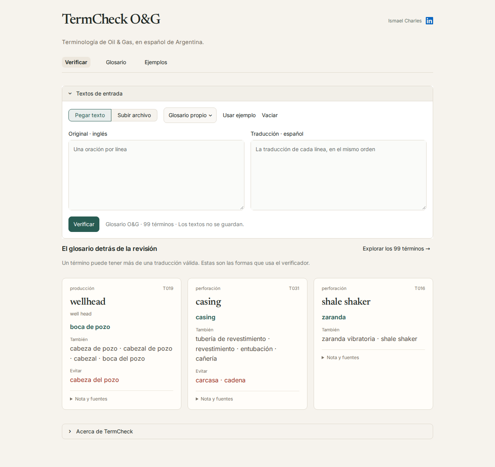

# TermCheck O&G

Verificador de terminología para traducción automática inglés → español en Oil & Gas upstream, con el español
técnico de Argentina como variante. Está pensado para quien post-edita o revisa traducciones técnicas y hoy
controla los términos a ojo, segmento por segmento.

Recibe el texto en inglés, su traducción y un glosario bilingüe. Señala formas desaconsejadas por ese glosario,
términos en inglés que no se aceptan como préstamos y equivalencias que no pudo encontrar. La persona que revisa
decide cada caso en contexto. No traduce ni corrige estilo.

**Versión pública: 0.2.1 · Glosario: 1.1 · 99 términos.** Se puede usar el glosario incluido o uno propio con las
preferencias del cliente. La evaluación histórica se conserva con su código y su glosario identificados.

## 1. El problema

La traducción automática produce frases fluidas y aun así falla en los términos del dominio. En un procedimiento
de perforación o de seguridad, un término mal traducido es un error caro, y cuesta verlo porque la frase suena
bien. Los glosarios generales tampoco alcanzan: muchas formas que se usan en España o en otros países no son las
que se usan en un yacimiento argentino.

<!-- autor:ejemplos:inicio -->
Dos ejemplos del conjunto de prueba, revisados según el criterio del autor para el español técnico de Argentina.
La distinción entre una forma preferida, una variante aceptable y un error depende del contexto y del encargo.

**1. DeepL**

- Inglés: *The driller stops the drill string from rotating, and hoists the drill string with the drawworks
  until the kelly is out of the rotary table.*
- Traducción: «El perforador detiene la rotación de la sarta de perforación y la iza con el **cabrestante**
  hasta que la **varilla Kelly** sale de la **mesa giratoria**.»
- En Argentina se dice **malacate**, **kelly** y **mesa rotativa**.

**2. Opus-MT**

- Inglés: *After the casing is landed, drilling fluid is circulated through the casing and annulus to remove
  any residual gases and to condition the mud.*
- Traducción: «Una vez desembarcada la **carcasa**, el fluido de perforación circula a través de la
  **carcasa** y el **anillo** para eliminar los gases residuales y acondicionar el barro.»
- En Argentina se dice **casing** o **cañería**, y **espacio anular**. DeepL también puso «anillo» en esta
  oración.
<!-- autor:ejemplos:fin -->

## 2. Demo

Se puede probar sin cuenta en **https://termcheck.aval.site/demo**

Pegá el inglés y la traducción y tocá «Verificar», o elegí «Usar ejemplo» para probar con tres oraciones de
desarrollo traducidas con Opus-MT. La revisión muestra un segmento por vez, primero con lo que hay que revisar;
podés consultar también las formas aceptadas y descargar el reporte completo. También acepta archivos TSV/CSV,
XLIFF y TMX, y un glosario propio en CSV. Corre en un servidor compartido, así que tiene límites: archivos de hasta 1 MB, 200 segmentos y 20.000
letras por lado. Los textos no se guardan.

El [glosario completo](https://termcheck.aval.site/demo/glosario) también se consulta sin cuenta: búsqueda en
inglés o español, filtro por área, fichas con variantes, notas y fuentes, y descarga del CSV que usa la demo.
La sección Ejemplos explica las etiquetas del verificador. Podés recorrer ambas sin perder la revisión en curso.

Pegá una pareja de segmentos por línea, en el mismo orden en ambos cuadros. Si la cantidad de líneas no coincide,
se pide corregir la alineación antes de verificar. En CSV/TSV se necesitan exactamente dos columnas; una traducción
vacía se puede revisar como posible omisión. Se aceptan comas, punto y coma o tabulaciones como separadores.

La revisión cubre únicamente los términos reconocidos del glosario. Cero avisos no demuestra que toda la traducción
esté bien; cuando no hay términos reconocidos, la app lo informa expresamente.



*Captura de la interfaz 0.2 con glosario v1.*

## 3. Cómo funciona

```
 glosario.csv ─┐
               ├─► [1] Normalizar ─► [2] Detectar términos ─► [3] Buscar traducción ─► [4] Clasificar ─► [5] Reporte
 origen (EN) ──┤     (minúsculas,       en el inglés             en el español           (etiqueta por     (HTML y CSV)
 destino (ES) ─┘      tildes, guiones)  (lemas y categoría)      (lemas, número y género) aparición)
```

1. **Normalizar.** Se comparan los textos en minúsculas, sin tildes y con los guiones unificados. El reporte
   muestra el texto original.
2. **Detectar los términos en inglés.** Cada término del glosario se busca en la oración de origen por lema y
   por forma, con spaCy. En los términos de una palabra se mira la categoría gramatical, para no confundir el
   sustantivo «well» con «as well as». Si dos términos se pisan, gana el más largo.
3. **Buscar la traducción.** Para cada término detectado se buscan en la traducción la forma preferida, las
   formas válidas y las prohibidas. El español cambia en género y número, así que se compara por lema y, como
   respaldo, se igualan el plural y el género. Una palabra con guion cuenta como sus partes («gas-lift» es
   «gas lift»). Una forma de varias palabras también vale cuando va coordinada con otra y comparten el principio
   («pozo de petróleo o gas» por «pozo de gas»).
4. **Clasificar** cada aparición con una etiqueta.
5. **Reportar.** Un HTML con los términos resaltados por color y un CSV con una fila por aparición.

| Etiqueta | Qué significa | Se marca para revisar |
|---|---|---|
| `OK` | Aparece la traducción preferida | No |
| `VARIANTE` | Aparece una forma válida que no es la preferida | No, es informativa |
| `PROHIBIDO` | Aparece una forma que el glosario da por incorrecta | Sí |
| `SIN_TRADUCIR` | El término quedó en inglés y el glosario no lo acepta como préstamo | Sí |
| `NO_ENCONTRADO` | El término está en el inglés y ninguna forma conocida aparece en la traducción | Sí |
| `INCONSISTENTE` | En el mismo documento, el término se tradujo de más de una manera | Advertencia |

Los casos difíciles (plural y género, tildes, «as well as», términos que se pisan, préstamos aceptados, siglas,
variantes de escritura en inglés, guiones, formas coordinadas) están cubiertos con pruebas automáticas en
`tests/test_hard_cases.py` y `tests/test_version_02.py`.

## 4. Resultados

El verificador se mide contra una anotación humana hecha a ciegas: para cada término del glosario en cada
traducción, el autor anotó si estaba bien o mal sin ver qué sistema la produjo ni qué decía el verificador. Se
tradujeron 120 oraciones con tres sistemas (Opus-MT, Claude sin glosario y DeepL).

- **Recall:** de los errores que anotó el autor, qué parte marca el verificador. Es la medida que más importa.
- **Precisión:** de lo que marca el verificador, qué parte era un error.
- **Baseline:** el método ingenuo, que busca la forma preferida como texto exacto. La diferencia con el
  verificador es lo que aporta comparar por lema y aceptar las formas válidas del glosario.

<!-- resultados:fijos (evaluación final, hecha con la versión 0.1; scripts/actualizar_readme.py ya no cambia estas tablas) -->
Evaluación final sobre el conjunto de prueba, con el glosario v1 congelado. Calculada el 2026-11-14 con la
versión 0.1 del verificador.

120 términos anotados en 20 oraciones (53 errores según la anotación). El verificador no detectó 0 de ellos (cuentan como no marcados).

Los 120 casos son 40 unidades de término y oración traducidas por tres sistemas: no son 120 contextos distintos.
La anotación considera error también una forma que el autor juzga inadecuada para el uso argentino. Los porcentajes
por sistema describen esta muestra y este criterio; no miden la calidad general de esos traductores automáticos.

### Verificador frente al baseline

| Método | Términos | TP | FP | FN | TN | Precisión (IC 95 %) | Recall (IC 95 %) | F1 |
|---|---:|---:|---:|---:|---:|---|---|---:|
| Baseline (texto exacto) | 120 | 52 | 18 | 1 | 49 | 0,74 (0,63–0,83) | 0,98 (0,90–1,00) | 0,85 |
| TermCheck | 120 | 49 | 7 | 4 | 60 | 0,88 (0,76–0,94) | 0,92 (0,82–0,97) | 0,90 |

### Por sistema de traducción (TermCheck)

| Sistema | Términos | TP | FP | FN | TN | Precisión (IC 95 %) | Recall (IC 95 %) | F1 |
|---|---:|---:|---:|---:|---:|---|---|---:|
| claude | 40 | 3 | 2 | 1 | 34 | 0,60 (0,23–0,88) | 0,75 (0,30–0,95) | 0,67 |
| deepl | 40 | 21 | 2 | 2 | 15 | 0,91 (0,73–0,98) | 0,91 (0,73–0,98) | 0,91 |
| opusmt | 40 | 25 | 3 | 1 | 11 | 0,89 (0,73–0,96) | 0,96 (0,81–0,99) | 0,93 |

### Errores de terminología según la anotación, por sistema

| Sistema | Términos | Errores | % | Error de término | Omisión | Sin traducir |
|---|---:|---:|---:|---:|---:|---:|
| claude | 40 | 4 | 10,00 | 4 | 0 | 0 |
| deepl | 40 | 23 | 57,50 | 23 | 0 | 0 |
| opusmt | 40 | 26 | 65,00 | 25 | 1 | 0 |

### Recall por tipo de error (TermCheck)

| Etiqueta del dueño | Casos | Detectados |
|---|---:|---:|
| ERROR_TERMINO | 52 | 49 |
| OMISION | 1 | 0 |
| SIN_TRADUCIR | 0 | 0 |

### Qué etiqueta dio el verificador según la anotación

| Anotación \ Verificador | OK | VARIANTE | PROHIBIDO | SIN_TRADUCIR | NO_ENCONTRADO | (no detectado) |
|---|---:|---:|---:|---:|---:|---:|
| CORRECTO | 51 | 10 | 0 | 0 | 6 | 0 |
| ERROR_TERMINO | 1 | 2 | 7 | 0 | 42 | 0 |
| OMISION | 0 | 1 | 0 | 0 | 0 | 0 |
| SIN_TRADUCIR | 0 | 0 | 0 | 0 | 0 | 0 |

IC 95 %: intervalo de Wilson por caso. No corrige la dependencia entre términos de una misma oración ni entre
las tres traducciones del mismo original. Con pocos contextos, se interpreta como referencia descriptiva,
no como garantía de generalización.
<!-- resultados:fin -->

### Hallazgos

<!-- autor:hallazgos:inicio -->
Los números salen de 20 oraciones y 120 términos. Alcanzan para ver tendencias y no para afirmarlas.

**Sistemas de traducción.** Claude tuvo 4 errores en 40 términos (10 %). DeepL tuvo 23 (57,5 %) y Opus-MT 26
(65 %). Los tres recibieron las mismas oraciones y ninguno recibió el glosario.

- Opus-MT traduce palabra por palabra: «obras de dibujo» por *drawworks*, «ascensores» por *elevators*,
  «carcasa» por *casing*, «taladro» por *driller*.
- DeepL escribe frases correctas con términos de español general: «cabrestante» por *drawworks*, «tenazas»
  por *tongs*, «plataformas» por *rig*, «tubería» por *tubing*.
- Los 4 errores de Claude son formas más generales que la del glosario: «equipo» por *rig*, «cable» por
  *wireline*, «línea de suministro» por *flowline* y «reacondicionamiento» por *workover*.

**Tipos de error.** De los 53 errores, 52 son un término equivocado y 1 es una omisión. Ningún sistema dejó un
término sin traducir. Los términos con más errores fueron *wireline* y *workover* (5 cada uno), y *drawworks*,
*tongs* y *tubing* (4 cada uno). En varios de ellos la forma que se usa en Argentina es la inglesa (wireline,
workover, tubing, top drive, kelly) y el error del sistema fue traducirla.

**El verificador.** Marcó 49 de los 53 errores y dio 7 falsas alarmas. El baseline marcó 52 y dio 18 falsas
alarmas. La ganancia está en la precisión, porque el verificador acepta las formas válidas del glosario y los
plurales. A cambio se le escapan 4 errores, y al baseline 1.

Los 4 errores que no marcó:

- 2 son *workover* en una misma oración. El glosario acepta «reparación» y el verificador la dio por
  encontrada en «repararse» y «reparada», que estaban en otra parte de la oración y traducían *repaired*.
- 1 es «varilla Kelly». El verificador encontró «kelly», que es una forma válida, y no mira las palabras que
  la rodean.
- 1 es «boca del pozo», que el glosario v1 lista como válida y el autor anotó como error. Ahí el que está mal
  es el glosario.

Las 7 falsas alarmas:

- 3 son «pozo de petróleo o gas» por *oil or gas well*. El verificador busca «pozo de gas» con las palabras
  juntas.
- 2 son «perforación» por *perforating*. El autor la considera aceptada y el glosario solo lista
  «punzado».
- 1 es «gas-lift» escrito con guion.
- 1 es *kelly spinner* traducido como «enroscador del vástago». El autor acepta «vástago» solo y el glosario
  lista «vástago de perforación».

El análisis por causa está en [`docs/findings.md`](docs/findings.md).
<!-- autor:hallazgos:fin -->

### Versión 0.2

Después de la evaluación final se arreglaron en el verificador tres de las causas de error que aparecen arriba.

- **Guion.** «gas-lift» se lee igual que «gas lift».
- **Coordinación.** «pozo de petróleo o gas» vale por «pozo de gas». Una forma de varias palabras se reconoce
  cuando va coordinada con otra y las dos comparten el principio.
- **Familia de palabras.** «repararse» y «reparada» ya no pasan por «reparación». El respaldo dejó de comparar
  por raíz y solo iguala el plural y el género.

La versión 0.2 se midió una sola vez sobre la misma prueba, con el mismo glosario y la misma anotación.

| Versión | TP | FP | FN | TN | Precisión (IC 95 %) | Recall (IC 95 %) | F1 |
|---|---:|---:|---:|---:|---|---|---:|
| 0.1, la evaluación final | 49 | 7 | 4 | 60 | 0,88 (0,76–0,94) | 0,92 (0,82–0,97) | 0,90 |
| 0.2 | 51 | 3 | 2 | 64 | 0,94 (0,85–0,98) | 0,96 (0,87–0,99) | 0,95 |

**El número de la 0.2 es optimista y no reemplaza al de la 0.1.** Los tres arreglos salieron de leer los errores
de esta misma prueba, así que para la 0.2 la prueba ya no es un conjunto que el código no vio. Cambiaron los seis
casos que se buscaba arreglar y ningún otro. La medida del proyecto sigue siendo la de la 0.1.

Para no ajustar de más, cada regla se escribió como regla general y se probó con oraciones inventadas
(`tests/test_version_02.py`). Los cambios se miraron solo en el conjunto de desarrollo: ahí desaparecieron las 3
falsas alarmas de «pozo de petróleo o gas» y no cambió ninguna otra etiqueta (F1 de 0,96 a 0,99). La detección de
términos en inglés salió idéntica en las 120 oraciones. El código se cerró antes de correr la prueba.

Siguen igual las 3 falsas alarmas y los 2 errores sin marcar que dependen del glosario o de mirar las palabras
que rodean al término: «perforación» por *perforating*, «vástago» por *kelly*, «varilla Kelly» y «boca del pozo».
Quedan 60 oraciones del conjunto de prueba sin anotar. Anotarlas daría una medida de la 0.2 sin este sesgo.

### Versión pública 0.2.1 y glosario 1.1

La versión 0.2.1 conserva las reglas de detección de 0.2 y corrige el tratamiento de entradas y la presentación de
la cobertura: impide verificar con glosarios inválidos, informa las filas defectuosas y evita presentar un texto sin
términos reconocidos como una revisión correcta. También corrige colisiones de identificadores en XLIFF/TMX y
rechaza pares de idiomas declarados incompatibles con inglés → español.

El glosario 1.1 aplica tres decisiones del autor ya registradas el 14/11: retira «boca del pozo» de las variantes de
*wellhead*, acepta «vástago» para *kelly* y acepta «perforación» para *perforating*. Se mantiene el glosario v1 original
y no se modifica la anotación ni las tablas históricas. El [registro del glosario](data/glossary/glossary_v1_1.md)
documenta las diferencias.

No se atribuyen a esta combinación las métricas de 0.1 ni las de 0.2 con el glosario v1. Las correcciones del glosario
provienen del análisis ya publicado; volver a medirlas en esos mismos casos no sería una evaluación independiente.

## 5. Validación

No hubo entrevistas ni pruebas con traductores. El plan original preveía mostrarle la herramienta a entre 3 y 5
personas; eso no se hizo. Hasta ahora el verificador se midió solo contra la anotación del autor y nadie más lo
usó con textos propios.

## 6. Limitaciones

- **Pocos datos.** La prueba tiene 20 oraciones (el plan preveía 80) y el conjunto de desarrollo 15. Los
  intervalos de confianza son anchos y los números son orientativos.
- **Un solo anotador humano.** La anotación refleja el criterio de una persona. El segundo anotador fue un
  modelo de lenguaje (Claude Fable 5.2), que anotó a ciegas las mismas oraciones y solo se usó para medir el
  acuerdo. En la prueba coincidieron en 98 de 120 términos (acuerdo 0,82; kappa de Cohen 0,62 con las cuatro
  etiquetas y 0,61 con correcto o error), medido antes de que el autor corrigiera una etiqueta. En desarrollo, sobre 111 términos, el kappa fue 0,55 y 0,54. En casi
  todos los desacuerdos el autor marcó error y el modelo, correcto.
- **«Correcto» por defecto.** La pantalla de anotación tiene un botón que pone «Correcto» en todo lo que falta
  de una oración. Ahorra tiempo y puede hacer que algún error pase como correcto.
- **Fuentes del glosario.** El respaldo escrito es sobre todo un glosario general de español sin variedad
  regional. Parte de los apuntes de curso que se consultaron se generaron con herramientas de IA y no sirven
  como prueba de uso argentino. Donde las fuentes no alcanzaban, la forma preferida es criterio de campo del
  autor. El detalle está en `data/glossary/SOURCES.md`.
- **Glosario chico y solo de sustantivos.** Son 99 términos. 20 de ellos no aparecen en ninguna oración del
  corpus, así que no se evaluaron.
- **El corpus son textos del gobierno de EE. UU.** (OSHA y reglamentos federales). Es inglés de normas y de
  seguridad, no documentación operativa de una empresa.
- **`NO_ENCONTRADO` no distingue causas.** Puede ser un error, una omisión o un sinónimo correcto que el
  glosario no lista. Lo decide quien revisa.
- **No hay alineación de palabras.** El verificador busca las formas dentro del segmento entero. Si un término
  aparece dos veces y una sola está bien traducida, puede no verlo.
- **Términos dentro de otros.** Si un término del glosario queda dentro de otro más largo, solo se evalúa el
  largo.
- **La coordinación se reconoce de un solo lado.** Vale «pozo de petróleo o gas» por «pozo de gas». No vale
  «lodo o fluido de perforación» por «lodo de perforación».
- **Una sola variante y un solo par de lenguas.** Inglés → español técnico de Argentina.
- **Las traducciones no se pueden repetir igual.** Claude y DeepL pueden contestar distinto otro día. La fecha
  y la versión de cada sistema están en `data/mt/versiones.csv`.

## 7. Cómo usarlo

Probado en Linux con Python 3.12.

```
python3 -m venv .venv
.venv/bin/pip install -r requirements.txt
.venv/bin/python -m spacy download en_core_web_sm
.venv/bin/python -m spacy download es_core_news_sm
```

`requirements.txt` alcanza para verificar y usar la app. Para volver a traducir con Opus-MT
(`scripts/translate_opusmt.py`), instalá además `requirements-mt.txt`. Para torch sin GPU, seguí la indicación
en ese archivo.

Verificar un par de archivos de texto, con una oración por línea y en el mismo orden:

```
.venv/bin/python scripts/run_check.py --src origen.txt --tgt traduccion.txt --out salida/mio
```

Verificar un archivo XLIFF 1.2, XLIFF 2.0 o TMX. La página Verificar también los acepta en «Subir archivo»:

```
.venv/bin/python scripts/run_check.py --file proyecto.xliff --out salida/proyecto
```

Escribe `salida/mio.csv` y `salida/mio.html`. Con `--glossary` se usa otro glosario, con las mismas columnas que
`data/glossary/glossary_en_es.csv`.

La demo en la propia máquina (solo la página de verificación):

```
.venv/bin/streamlit run app/demo.py
```

La app completa, con el glosario, la anotación y los resultados, sin inicio de sesión:

```
TERMCHECK_SIN_LOGIN=1 .venv/bin/streamlit run app/streamlit_app.py
```

Las dos quedan en http://127.0.0.1:8501.

Las pruebas automáticas y la evaluación:

```
.venv/bin/python -m pytest -q
.venv/bin/python scripts/evaluate.py
```

Qué hay en cada carpeta:

| Carpeta | Contenido |
|---|---|
| `src/termcheck/` | El verificador: glosario, normalización, detección, clasificación, consistencia y reporte |
| `scripts/` | Armado del corpus, traducción, división en conjuntos, verificación, baseline y evaluación |
| `app/` | La app web (Streamlit): glosario, traducciones, anotación, verificación y resultados; `demo.py` es la demo pública |
| `data/` | Glosario, corpus, traducciones, división en conjuntos y anotación |
| `tests/` | Pruebas automáticas, con un proyecto inventado que no toca los datos reales |
| `docs/` | La guía de anotación y los hallazgos |

## 8. Datos y licencias

- **Código:** MIT (archivo `LICENSE`).
- **Corpus:** 120 oraciones en inglés de textos del gobierno federal de EE. UU., sin copyright. Cada una lleva
  la dirección de su página de origen.
- **Glosario, anotación y traducciones:** hechos para este proyecto. Su licencia todavía no está definida.

Las fuentes de cada término, lo que se excluyó por copyright y el método de cada sistema de traducción están en
[`data/glossary/SOURCES.md`](data/glossary/SOURCES.md) y en [`data/mt/README.md`](data/mt/README.md).

## 9. Próximos pasos

- Anotar las 60 oraciones de prueba que faltan, para medir la versión 0.2 con oraciones que el código no vio.
- Un segundo anotador humano sobre una parte de la prueba, para medir el acuerdo entre personas.
- Más formas prohibidas en el glosario, cada una con un error real que la respalde.
- Probar la lectura de XLIFF y TMX con exportaciones reales de Trados y memoQ. Hoy lee XLIFF 1.2, XLIFF 2.0 y TMX
  según la norma, probados con archivos armados a mano. No lee `.sdlxliff` ni `.mqxliff`.
- Probar la herramienta con traductores que hagan post-edición técnica.
